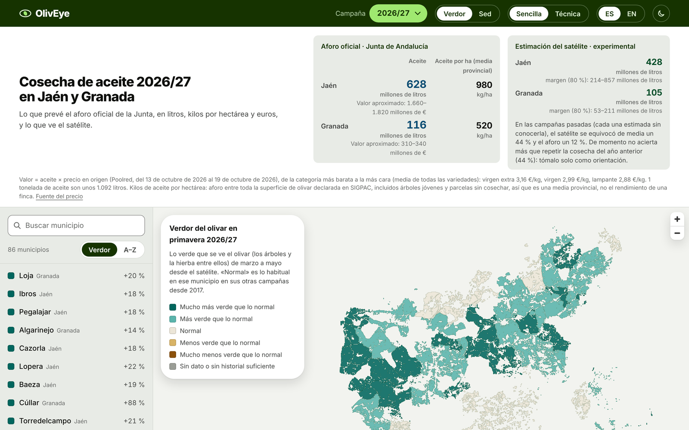
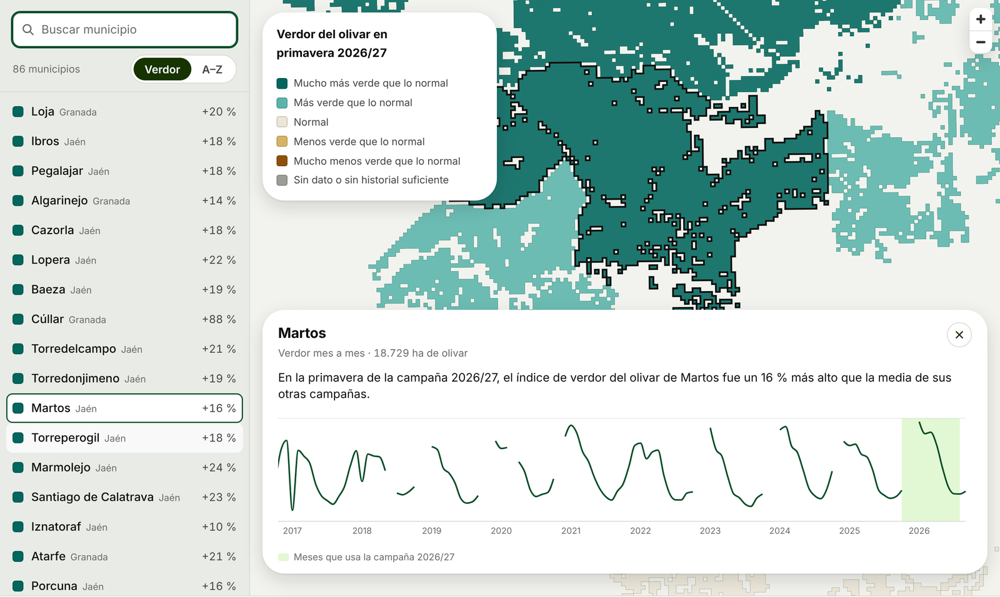
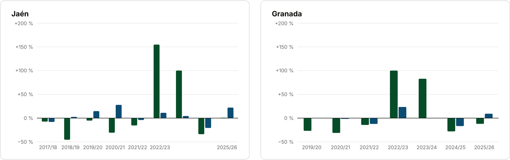
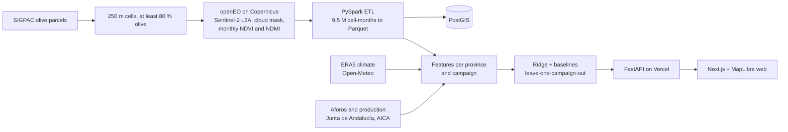

<div align="center">

# OlivEye

**Can a satellite forecast the olive oil harvest before the official forecast?**<br>
Sentinel-2 imagery over the olive groves of Jaén and Granada, an honestly validated model,<br>
and a web map built for the people who grow the olives.

[](https://oliveye.vercel.app)
[](https://oliveye-api.vercel.app/docs)
[](https://github.com/N13T4C0/oliveye/actions/workflows/ci.yml)


[](LICENSE)

<a href="https://oliveye.vercel.app">
  <picture>
    <source media="(prefers-color-scheme: dark)" srcset="docs/media/hero-dark.png">
    
  </picture>
</a>

</div>

## The short answer: not yet

| | Mean error per campaign |
|---|---|
| **Official forecast** (*aforo*, Junta de Andalucía, October, field samples) | **12 %** |
| **OlivEye** (satellite + climate up to August) | **44 %** |
| Simply repeating last year's harvest | 44 % |

With 9 campaigns of data the model shrinks to each province's average: it does not beat
repeating last year, and the aforo, which samples olives in the field, is about 3–4 times more
accurate. Every number was computed leave-one-campaign-out, and the project says so on the page
instead of hiding it. [Full results and limitations](docs/results/README.md).

## What you can do on the web

<table>
<tr>
<td width="50%"></td>
<td width="50%"></td>
</tr>
<tr>
<td><b>Your municipality, compared with its own history.</b> Is this year's olive grove greener or
thirstier than usual? 86 municipalities, monthly since 2016, with a plain sentence for each.</td>
<td><b>Every campaign's error, in the open.</b> How far OlivEye and the aforo were from the final
harvest, campaign by campaign, with back-calculated figures marked.</td>
</tr>
</table>

- **Two views.** *Simple* (default) speaks in litres, kilos per hectare and euros for growers;
  *Technical* shows NDVI, NDMI, MAPE and the per-campaign errors.
- **Light and dark themes**, Spanish and English, desktop and mobile.
- **Public read-only API** ([docs](https://oliveye-api.vercel.app/docs)): municipalities, monthly
  indices, production, model scores, per-campaign errors, the dated forecast and the map.

## How it works



Key decisions, each with its reasoning and alternatives (ADRs):

| | Decision |
|---|---|
| [0001](docs/decisions/0001-openeo-extraction-strategy.md) | Aggregate on the server with openEO and a 250 m olive grid, never download rasters (free Copernicus quota) |
| [0002](docs/decisions/0002-target-variable.md) | Target: final production per province, back-calculated from the Junta's published variations |
| [0003](docs/decisions/0003-model-design.md) | Ridge with 4 features fixed in advance, campaign *and* the next one held out, conformal interval |
| [0004](docs/decisions/0004-no-xgboost.md) | XGBoost tested and dropped: worse with 15 rows |
| [0005](docs/decisions/0005-web-and-api-on-vercel.md) | Web and API on Vercel, the API serving small pre-computed JSON |
| [0006](docs/decisions/0006-pyspark-etl.md) | PySpark ETL proven identical to pandas (1e-15), and honestly not faster at this size |
| [0007](docs/decisions/0007-more-campaigns-sentinel2-2015.md) | More campaigns from Sentinel-2 back to 2015 rather than Landsat (Level-1 only on CDSE) |

## Built with Claude

The author worked as project lead with Claude (Opus) as the development team: he decided what to
build, reviewed every step and approved anything that spent credits or was published.

- **Specialised review agents** ([`.claude/agents/`](.claude/agents/)) gated the work: a project
  auditor (Copernicus credit rules, data leakage across campaigns, no secrets in git), a code
  reviewer, and a statistician plus a model-QA agent before any metric was published.
- **Skills** ([`.claude/skills/`](.claude/skills/)): test-driven development, a "grilling" session
  that produced the model design (ADR 0003), architecture decision records, and a design guide
  for the web ([`DESIGN.md`](DESIGN.md)).
- **Scheduled tasks and a job queue** let work continue unattended: openEO jobs run on GitHub
  Actions from files in [`jobs/`](jobs/), always as a dry run first ([automation](docs/automation.md)).

## Tech stack

| Layer | Tools |
|---|---|
| Earth observation | openEO, Copernicus Data Space Ecosystem, Sentinel-2 L2A |
| Geodata | GeoPandas, Shapely, PostGIS (EPSG:4326 storage, EPSG:25830 areas) |
| Big data | PySpark, Parquet |
| Models | scikit-learn, MLflow |
| API | FastAPI, Pydantic |
| Web | Next.js, React, TypeScript, MapLibre GL, Recharts |
| Quality | pytest, Vitest, ruff, mypy `--strict`, ESLint, Prettier, GitHub Actions |
| Deploy | Vercel (web and API), Docker (PostGIS) |

## Run it locally

Requirements: [uv](https://docs.astral.sh/uv/), Node.js 22, Docker. A free
[Copernicus](https://dataspace.copernicus.eu/) account is only needed to extract new imagery.

```bash
git clone https://github.com/N13T4C0/oliveye.git && cd oliveye
uv sync                                                   # Python environment

# API with the published data
uv run uvicorn app:app --app-dir api --reload             # http://127.0.0.1:8000/docs

# Web
cd web && npm ci && NEXT_PUBLIC_API_URL=http://127.0.0.1:8000 npm run dev

# Optional: PostGIS with the same data
cp .env.example .env && docker compose up -d
uv run --extra db python scripts/load_postgis.py
```

Notebooks in [`notebooks/`](notebooks/) walk through the data: SIGPAC olive parcels, production
history and alternate bearing, and the model results.

## Limitations

- Only 9 campaigns since Sentinel-2: every metric is noisy (the gap to the aforo is suggestive,
  p = 0.055, not conclusive).
- 15 of 16 final production figures are back-calculated from the Junta's published variations.
- The satellite sees the grove in spring and summer; the aforo counts fruit in October.
- Features cover about 80 % of each province's declared olive area; inside the measured
  municipalities, cells sample 79 % (Jaén) and 59 % (Granada) of the hectares.

**Dated forecast 2026/27** (published 2026-10-25, to be scored when the final figure is out):
Jaén 392 kt (196–785), Granada 96 kt (48–193), against an aforo of 575 / 106.7 kt.
[Details](docs/results/forecast-2026-27.md).

## Data sources

- **Sentinel-2 L2A**: Copernicus Data Space Ecosystem, via openEO.
- **SIGPAC**: agricultural parcel registry (FEGA, Junta de Andalucía).
- **Climate**: ERA5 daily reanalysis via [Open-Meteo](https://open-meteo.com/).
- **Production and aforo**: Junta de Andalucía, AICA. **Prices**: Poolred (dated, in
  [`docs/sources/`](docs/sources/)).

## License

MIT for the code ([LICENSE](LICENSE)). Data remain under the licenses of their providers.

<div align="center"><sub>A portfolio project by José Antonio Nieto · Granada, 2026</sub></div>
