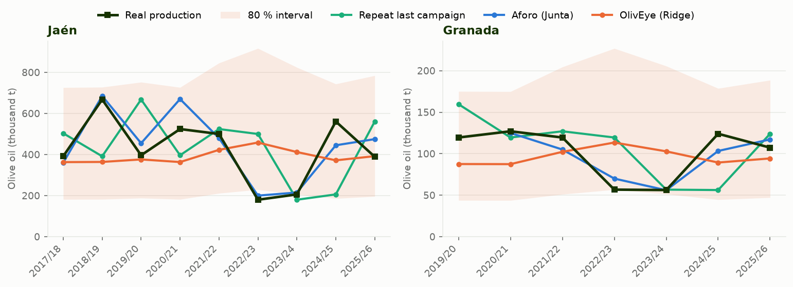

# DRAFT — Results section for the README (for the author to review)

> Status: **skeleton, no numbers yet.** It is filled only from a run on the complete
> 85-municipality data, after `model-qa` and `oliveye-auditor` have reviewed it. The author
> decides the headline and whether it goes into the README.
> Every `{…}` is a placeholder taken from `data/processed/model_run/` (summary.csv, run.json).

## Results

**Question:** with satellite (Sentinel-2) and climate data up to August, can a simple model
forecast a province's olive oil harvest as well as the official forecast (*aforo*) published by
the Junta de Andalucía in October (which also uses field fruit counts)?

**Short answer:** {one honest sentence, e.g. "Not yet: the aforo is about {x}× more accurate"
or "On {k} of {n} campaigns it was closer than the aforo, but the difference is not
statistically clear (p = {p})."}

| Model (same {rows} rows, {campaigns} campaigns) | MAPE | Median APE | Campaigns closer than the aforo |
|---|---|---|---|
| Aforo (Junta, October, field counts) | {…} % | {…} % | – |
| **OlivEye — Ridge, data to August** | {…} % | {…} % | {k} / {n} (p = {p}) |
| Repeat last campaign | {…} % | {…} % | {…} |
| Province mean | {…} % | {…} % | {…} |

### How it was validated

- **Leave-one-campaign-out:** each campaign (both provinces) is predicted by a model that never
  saw it, nor the following campaign, whose "last year's production" feature would reveal it.
- **Forward check:** training only on earlier campaigns gives {…} % MAPE ({n} campaigns).
- Ridge regression on 4 features fixed in advance (last year's production, May heat days,
  summer NDMI, spring NDVI), with the province level unpenalised (ADR 0003).
- 80 % interval: forecast ÷/× {factor}, from the out-of-sample errors.

### Limitations (read before quoting a number)

- Only {campaigns} campaigns since Sentinel-2 (2015): every metric is noisy.
- Olive trees alternate heavy and light years; the aforo uses field fruit counts in October that
  a satellite cannot see in August.
- Granada lacks reliable figures for 2016/17 and 2017/18 (rows dropped, not imputed).
- Features cover {jaen} % of Jaén's and {granada} % of Granada's SIGPAC olive area.

### Next test

A dated 2026/27 forecast is published next to the aforo ({…} kt Jaén, {…} kt Granada) and will
be scored when the Junta's final figure is known. *(Pending the author's confirmation.)*
