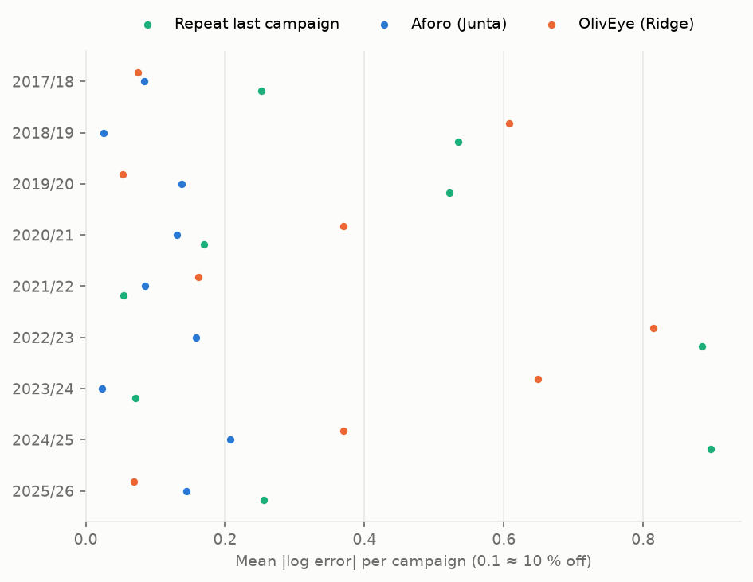

# Results — 2026-10-25 run

Reviewed by `model-qa` (replicated byte-identical; verdict *publishable with caveats*) and
`oliveye-auditor` (no leakage across campaigns; credit rules respected) before being written
here. Raw outputs of this run: [`run-2026-10-25/`](run-2026-10-25/). Method: ADR 0003 and its
2026-10-25 amendment.

## Summary

Across 9 campaigns (15 province-campaigns, leave-one-campaign-out), the Ridge model's MAPE was
**44 %**, indistinguishable from repeating last campaign (44 %) or using the province mean
(45 %): with so little data, shrinkage removed the satellite and climate features, so the model
reduces to the province average. The Junta's aforo, published in October with field fruit
counts, had a MAPE of **12 %**, about 3–4× lower depending on the metric, and was closer in
6 of 9 campaigns; with 9 campaigns this gap is suggestive rather than statistically conclusive
(exact sign-flip p = 0.055).

## Numbers (same 15 rows for every model)

| Model | MAPE | Median APE | Mean \|log error\| | Campaigns closer than the aforo | Sign-flip p vs aforo |
|---|---|---|---|---|---|
| Aforo (Junta, October, field counts) | 11.9 % | 11.2 % | 0.116 | – | – |
| OlivEye — Ridge, data to August | 44.1 % | 30.7 % | 0.373 | 3 / 9 | 0.055 |
| Repeat last campaign | 44.0 % | 28.6 % | 0.398 | 1 / 9 | 0.008 |
| Province mean | 45.4 % | 30.6 % | 0.378 | 3 / 9 | 0.062 |
| Mean of previous 5 campaigns | 47.2 % | 28.9 % | 0.348 | 3 / 9 | 0.051 |
| XGBoost (experiment, ADR 0004) | 51.0 % | 24.1 % | 0.479 | 2 / 9 | 0.023 |

- MAPE ratio Ridge / aforo: **3.7×**, campaign-block bootstrap 95 % CI **1.3–7.6×**
  (10,000 resamples of whole campaigns). On median APE the ratio is 2.7×; on mean |log error| 3.2×.
- Forward check (train only on earlier campaigns, 5 campaigns, 10 rows): Ridge 53.9 % vs aforo
  12.4 %. With 5 campaigns the smallest possible sign-flip p is 0.0625, so it supports no inference.
- p-values are descriptive: several models are compared with no multiplicity correction.

Per-campaign errors (also the table view of the second figure): [`per_campaign.csv`](run-2026-10-25/per_campaign.csv).

## What the model learned

The one-standard-error rule chose the strongest shrinkage (alpha = 1000) in 8 of 9 folds; the
standardised slopes are ~0.00 and the prediction is, in practice, the province mean. No feature
effect can be claimed. A labelled sensitivity check by `model-qa` (alpha at minimum inner error,
*not* the pre-registered method) made results worse (MAPE 63.5 %, computed just before the causal-filter fix): the features fit past
campaigns but do not predict new ones.

## Caveats (read before quoting a number)

- **n is 9 campaigns, not 15 rows:** both provinces of a campaign share its weather.
- **The aforo knows more:** it is published 16–28 October and uses field fruit counts; the model
  only uses data up to August. The comparison handicaps the model by design.
- **Truth is mostly derived:** 15 of the 16 final-production values are back-calculated from the
  Junta's aforo variations (ADR 0002, validated against AICA within 0.4 %); only Jaén 2018/19 is
  a reported figure. The 2025/26 value is provisional and may be revised.
- **Approximate aforo values:** 2017/18 Jaén ("en torno a 360.000 t") and 2019/20 Jaén ("algo más
  de 455.000 t") are rounded figures from press releases.
- **Interval:** the 80 % interval (forecast ÷/× 2.0) comes from all 16 out-of-sample residuals;
  its coverage cannot be validated on the same residuals.
- Features come from the 86 municipalities that hold 80.1 % of Jaén's and 80.6 % of Granada's SIGPAC
  olive area; inside them, pure olive cells (≥ 80 % olive) sample 79 % (Jaén) and 59 % (Granada) of
  the hectares, so about 64 % and 48 % of each province's olive area is measured directly
  (notebook 02).
- Granada has no reliable figures for 2016/17 and 2017/18 (rows dropped, not imputed).
